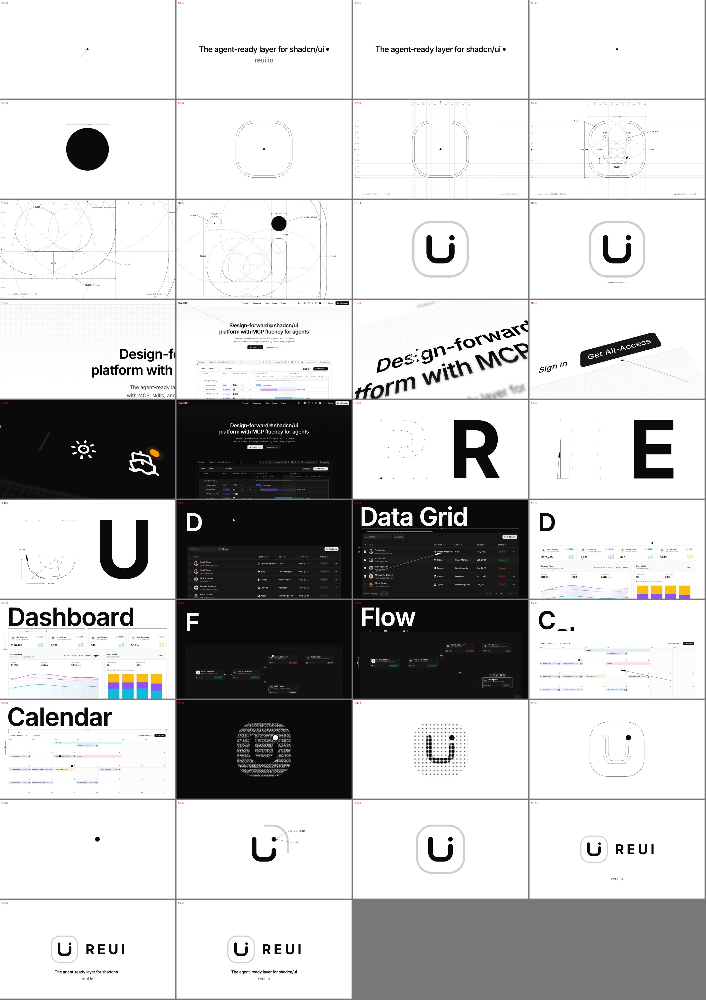

# brand-film

A [Claude Code](https://claude.com/claude-code) skill for making a logo-led brand identity film in
[Remotion](https://www.remotion.dev), in the style of OpenAI's "Refreshed" film:

- the logo's own dot leads every move
- the mark is drawn from its real construction lines and measurements
- the logo zooms out into the brand's website
- the name is spelled letter by letter on the music
- real product UI is driven by a real mouse
- the film ends on the brand's own line

About 60 s, 4K, 60 fps, cut to a music bed's beat grid.

It ships with the code and stills of a finished film for [ReUI](https://reui.io) as a working template.



## Install

Clone into your Claude Code skills folder:

```bash
git clone https://github.com/faizalmy/brand-film-skill.git ~/.claude/skills/brand-film
```

For one project only, clone into `<project>/.claude/skills/brand-film` instead.

Restart Claude Code, or start a new session. Then check that `brand-film` is in the skill list.

To update:

```bash
git -C ~/.claude/skills/brand-film pull
```

## Requirements

- Node 20.19+ and npm (Remotion 4 is installed by `npm i` in the template)
- ffmpeg for `ffprobe` checks: `brew install ffmpeg`
- bash (the QA script)
- Python 3 with Pillow (contact sheets): `pip install pillow`
- librosa and numpy (beat analysis of a music track): `pip install librosa numpy`
- Playwright (capture scripts): `npm i -D playwright && npx playwright install chromium` in the film's project, or
  set `PLAYWRIGHT_FROM` to a folder that has it
- A music bed you have the rights to use

The skill checks these itself and installs what is missing in the film's project. `npm i` in the template installs
Remotion. Run `npx remotion browser ensure` once for the browser it renders with. Remotion is free for
individuals and small teams; check [its license](https://remotion.dev/license) for company use.

## Use

Ask Claude Code in plain words, for example:

- "Make a brand film for <brand>, like the Refreshed one."
- "New version of the ReUI brand film with the new blocks."
- "Remove frame 3150 from the film."

The skill:

1. reads or writes a brand profile (`brands/<brand>.md`)
2. copies `template/` into a new project and captures the brand's site and product with a real mouse
3. adapts the logo, palette, text, product views and music
4. checks stills against the ReUI frames and runs a review by a separate agent
5. hands you a Remotion Studio preview

It renders the final 4K video only when you ask.

## Contents

| Path | What |
|---|---|
| `SKILL.md` | The method: language, story shape, rules, timing system, workflow |
| `brands/_new-brand.md` | Form to fill for a new brand |
| `brands/reui.md` | The ReUI profile |
| `template/` | Remotion project of the approved ReUI film. It plays after the captures and the music are in (below) |
| `template/src/scenes/` | One file per scene: line, ring, construct, site, letters, blocks, looks, final. Pick, reorder or remove them by name in the `SCENES` list in `template/src/Refreshed.tsx` |
| `scripts/qa.sh`, `qa.mjs`, `sheet.py` | Render chosen frames as stills and build a contact sheet |
| `scripts/beat.py` | Tempo, first beat and drop of a music track |
| `scripts/reui/` | Capture scripts for reui.io (site, components, blocks); examples for other brands |
| `references/` | ReUI film map, its 38 frames, the review checklist and subagent brief |

The template ships no screenshots or music, so Studio shows errors until both are in. In a copy of `template/`:

1. `npm i`, then `npm i -D playwright && npx playwright install chromium`
2. Run the capture scripts from that folder, site first: `node <skill>/scripts/reui/site-object.mjs`, then
   `live.mjs`, `dash.mjs`, `block-live.mjs` (for another brand, adapt them first)
3. Save your track as `public/audio/bed.wav`
4. `npx remotion studio`

`<skill>` is where you cloned this repo.

## License

Code: MIT, see `LICENSE`. The ReUI name, logo, website, product UI and the demo content inside it (shown in
`references/reui-frames/`) belong to ReUI. They are here as an example. Do not reuse them as your own brand.

Inter is under the SIL Open Font License, see `template/public/fonts/OFL.txt`. The two sound effects in
`template/public/sfx/` were made by the author with ElevenLabs and may be used with this template.
